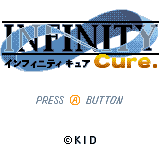
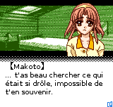
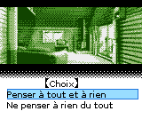

# Infinity Cure — traduction française

**Infinity Cure** (Neo Geo Pocket Color, KID, 2000, sorti uniquement au Japon), entièrement en
français : les 17 667 répliques du roman (prologue, tronc commun, routes de Yuka et d'Izumi, toutes les
fins), les 160 choix, les menus (options, sauvegarde, album) et même le menu de débogage caché.

<p align="center">
  
  
  
</p>

- **Partie 1 (français)** : jouer en français — le patch et comment l'appliquer.
- **Part 2 (English)** : the translation kit — tools and guide to translate the game into another language.

---

# Partie 1 — Jouer en français

## 1.1 Ce qu'il vous faut

Le patch, au choix :

| Fichier | Contenu |
|---|---|
| `patch/InfinityCure_FR_v1.0.ips` | la traduction française |
| `patch/InfinityCure_FR_debug_v1.0.ips` | la même, avec en plus le **menu de débogage** caché du jeu (voir 1.6) |

**Votre propre** copie de la cartouche **japonaise**, non modifiée et sans en-tête. Aucune ROM n'est
fournie ici. Vérifiez-la :

| | Infinity Cure (Japon) |
|---|---|
| Nom (par exemple) | `Infinity Cure (Japan).ngc` |
| Taille | 1 048 576 octets |
| CRC32 | `32DC2AA2` |
| MD5 | `4bda8b3669c5bbd72266853940d626cb` |
| SHA-1 | `b0f3f57c5ad084a009631e7e0fa497451415e73b` |

Si votre fichier contient déjà une partie sauvegardée (certains émulateurs l'écrivent dans la ROM), ses
empreintes seront différentes : ce n'est pas grave, le patch s'applique quand même. Avec une ROM déjà
modifiée ou un autre dump, le patch donnera un jeu cassé.

## 1.2 Méthode A — patch appliqué à la volée par l'émulateur

L'émulateur applique le patch en mémoire à chaque lancement : la ROM d'origine n'est **pas modifiée**.
Posez le fichier `.ips` à côté de la ROM, **sous le même nom**, puis lancez la ROM normalement :

```
Infinity Cure (Japan).ngc
Infinity Cure (Japan).ips
```

Ce patch **agrandit** la ROM (1 Mio → 4 Mio). En cas de souci avec l'application à la volée, utilisez la
méthode B.

## 1.3 Méthode B — créer une ROM française (console, ou tout autre émulateur)

Fabriquez une fois pour toutes une ROM patchée :

- avec un outil IPS courant : **Rom Patcher JS** (dans le navigateur), **Flips** ou **Lunar IPS** ;
  choisissez la ROM, puis le `.ips`, et enregistrez le résultat ;
- ou avec l'outil fourni (Python 3) :

  ```
  python tools/ips.py apply "Infinity Cure (Japan).ngc" patch/InfinityCure_FR_v1.0.ips InfinityCure_FR.ngc
  ```

Depuis la ROM d'origine attendue, la ROM obtenue doit avoir ces empreintes, quel que soit l'outil :

| | ROM française | ROM française + débogage |
|---|---|---|
| Taille | 4 194 304 octets | 4 194 304 octets |
| CRC32 | `5A65B72F` | `F0D45447` |
| SHA-1 | `3184d073c08e419be07659e7275b1be4b462b65b` | `f424c8c7509e2b1b712692dc579eb1d86f6d32f7` |

## 1.4 Jouer

- Les **menus de choix** apparaissent sans curseur : appuyez sur **BAS** pour le faire apparaître, puis
  choisissez avec HAUT/BAS et validez avec **A** (c'est ainsi dans le jeu d'origine).
- **A** affiche toute la page d'un coup ou passe à la suite ; **OPTION** ouvre le menu (sauvegarder,
  charger, options, quitter).
- La ROM française démarre **sans sauvegarde**. Le jeu enregistre en fin de cartouche ; la ROM traduite
  étant plus grande, la sauvegarde est rangée à la fin de la nouvelle taille (le jeu contient déjà le
  code prévu pour cela). Une sauvegarde faite avec la version japonaise n'est pas reprise.

## 1.5 Ce qui a été vérifié, ce qui ne l'a pas été (v1.0)

Vérifié à l'émulateur : prologue, démo du titre, début du 1er avril, dialogues avec nom du locuteur,
menus de choix, options, écriture de la sauvegarde, et une longue partie en lecture automatique
(environ 2 500 répliques affichées, sans aucun débordement). Menu de débogage : ouverture, visionneuse
des portraits, des illustrations et des musiques, sélection d'une journée.

Tout le texte est contrôlé automatiquement contre le japonais (codes d'attente et de page, nom du
locuteur, caractères disponibles, mise en page de chaque réplique) : la ROM n'est pas fabriquée s'il
reste une erreur. Pas encore vu à l'écran : la plupart des scènes des routes de Yuka et d'Izumi et les
fins, l'album. Un retour est bienvenu si un texte déborde ou se coupe. La ROM n'a pas encore été
essayée sur une vraie console.

## 1.6 Le menu de débogage (patch « debug »)

Le jeu contient un menu de test laissé par les développeurs, que rien n'appelle dans la cartouche
d'origine. Avec le patch « debug », **New Game** ouvre ce menu au lieu du prologue :

- **Jeu** : une partie normale, depuis le prologue.
- **Vérification** : visionneuse des 82 portraits (Persos), des 53 décors, des 12 illustrations
  (Scènes) ; page 2 : les 23 musiques et 7 bruitages. **A** passe à l'élément suivant.
- **Débogage** : TEST00 à TEST02 = choix d'une **journée** (1er-6 avril de la 1re boucle, 1er-7 avril
  de la 2e) ; TEST03 = choix d'un **chapitre** (ouverture, tronc commun jour par jour, route de Yuka,
  route d'Izumi « Cure »).

C'est l'outil des développeurs : une scène lancée ainsi part d'une partie vide, certains rappels
peuvent ne pas être cohérents. À réserver à la curiosité.

## 1.7 Choix de traduction

- Traduit depuis le **japonais** (il n'existe pas d'autre version), puis entièrement relu contre le
  japonais. On **adapte** plutôt qu'on ne traduit mot à mot : chaque réplique doit avoir du sens dite par
  ce personnage ; les jeux de mots sont remplacés par des équivalents français.
- Les **suffixes japonais** sont gardés (Makoto-kun, Izumi-san, Kurumi-chan, senpai, Onii-chan) et tout
  le monde se **tutoie** ; Kurumi parle parfois d'elle à la 3e personne, comme en japonais.
- Les **lieux** sont traduits (plage de la Princesse, plage de la Lune, sanctuaire du Bois de Shiki,
  parc panoramique…) ; le café Luna Beach garde son nom.
- Police : lettres à **largeur variable** (environ 28 caractères par ligne au lieu de 12), minuscules
  et accents ; le nom de celui qui parle s'affiche au-dessus du texte (【Makoto】) comme dans l'original.
  Quand le français est plus long, une page est ajoutée.
- Laissés tels quels : le logo et le menu de l'écran titre (« New Game / Continue / Option », déjà en
  anglais dans le jeu), les codes des visionneuses du menu de débogage.

## 1.8 Crédits

- **Traduction française, police, outils** : **Tixul**, sous **licence MIT** (fichier `LICENSE`) pour les
  outils et les fichiers de traduction. Les lettres de la police sont tirées de DejaVu Sans (licence
  libre Bitstream Vera / DejaVu).
- *Infinity Cure* © 2000 KID. Ce projet de fans n'est ni affilié ni approuvé par les ayants droit. Il ne
  contient **ni ROM, ni BIOS, ni texte d'origine** : le patch ne contient que des octets modifiés, et le
  texte japonais n'est obtenu qu'en l'extrayant de sa propre ROM.

---

# Part 2 — Translation kit (English)

Everything needed to translate the game into **another Latin-alphabet language**. You edit text files;
the tools rebuild the ROM (4 MiB: translated text in a second chip, variable-width font, speaker name
line, automatic line wrapping and extra pages, moved save area, translated menus) and refuse to build
while a rule is broken. The original script is left untouched: the game looks up each line's
translation by the address of the Japanese line.

| Folder / file | Content |
|---|---|
| `lang/fr/` | the French translation (`lot_NN_fr.tsv`), its glossary and style guide — use it as your template |
| `tools/` | extract the text, check a translation, build the translated ROM and the IPS patch |
| `patch/` | the released French patches |
| `screenshots/` | the screenshots shown at the top of this file |
| `FORMAT.md` | technical notes on the ROM: script, text compression, display, saves, debug menu (in French) |

## 2.1 Requirements
- Python 3.9 or later (no other package needed).
- The original **Japanese ROM** `Infinity Cure (Japan).ngc` (hashes in section 1.1): the game is rebuilt
  from it. The build checks it and refuses any other file (a save stored inside the file is ignored).

## 2.2 Steps
1. **Extract the text** from *your own* ROM (it is not distributed):
   ```
   python tools/extrait.py "Infinity Cure (Japan).ngc"
   ```
   This writes `out/jp.tsv`: `address · type (M = line, S = menu choice) · number · Japanese`, with the
   codes `▼` (wait, new page), `▽` (wait, next line), `⏎` (Japanese line break).
2. **Copy** `lang/fr` to `lang/<code>` (e.g. `lang/es`) and translate (rules below).
3. **Check, then build** the ROM and the patch, and test in an emulator:
   ```
   python tools/controle.py --rom "Infinity Cure (Japan).ngc" --lang <code>
   python tools/build.py --rom "Infinity Cure (Japan).ngc" --lang <code> --ips
   python tools/build.py --rom "Infinity Cure (Japan).ngc" --lang <code> --debug --ips   (debug menu)
   ```
   Output: `out/<code>.ngc` / `out/<code>_debug.ngc` and the `.ips` (checked by re-applying it).
   ⚠️ Distribute the **.ips** only, never the ROM.

## 2.3 File format and rules

Every `*.tsv` file in `lang/<code>/` is read (UTF-8; `#` starts a comment line). One line per text:
`ADDRESS<TAB>text`, the address being the one in `out/jp.tsv`. A Japanese text repeated elsewhere in
the script automatically gets the translation of its first occurrence; a line with no translation stays
in Japanese. `tools/controle.py` also lists the Japanese texts still untranslated.

In the text:
- `▼` / `▽` / `◇` / `◆`: keep exactly the same codes as the Japanese, in the same order.
- `⏎`: forced line break — usually **not** needed, lines are wrapped automatically (142 px, 4 lines
  per page under the name line; a longer text gets extra pages).
- `Name「line」`: the speaker, shown as 【Name】 above the text. Allowed names are listed in
  `tools/controle.py` (`NOMS`) and checked against the Japanese speaker (`CORR`): edit them for your
  language. Use 「 」 only for that.
- Menu choices (`S`): one line, 142 px at most.

Characters: `A-Z a-z 0-9`, `. , ; : ! ? ' " - ( ) [ ] / & ~ … « » — ♪ °` and
`é è ê ë à â ä î ï ô ö û ù ü ç œ æ É È Ê Ë À Â Î Ï Ô Û Ù Ç Œ Æ`; no `%`. Glyphs (12×12, with their
width) are in `tools/police_fr.txt`: add or replace characters there (free codes 0xA0-0xDF).

Language-specific data living in the tools (edit them for your language): `tools/menus.py` (`MENUS`:
options, save/load, quit, album, debug viewer texts — ≤ 18 characters), `tools/build.py`
(`TITRE_CHOIX`, the title above menu choices), `tools/controle.py` (speaker names).

The added code is `tools/asm/fr.asm`, shipped assembled (`fr.bin`, `fr.sym.json`). To change it,
install the Macro Assembler AS (`asl`, `p2bin`) and set `ASL_DIR` to its folder before building.

## 2.4 Credits and legal
- French translation, font and tools: **Tixul**, released under the **MIT License** (see `LICENSE`).
  The font's letters come from DejaVu Sans (Bitstream Vera / DejaVu free license).
- *Infinity Cure* © 2000 KID. This fan project is not affiliated with or endorsed by the rights holders.
  It contains **no ROM, no BIOS and no original game text**; the Japanese text is only obtained by
  extracting it from your own ROM.
